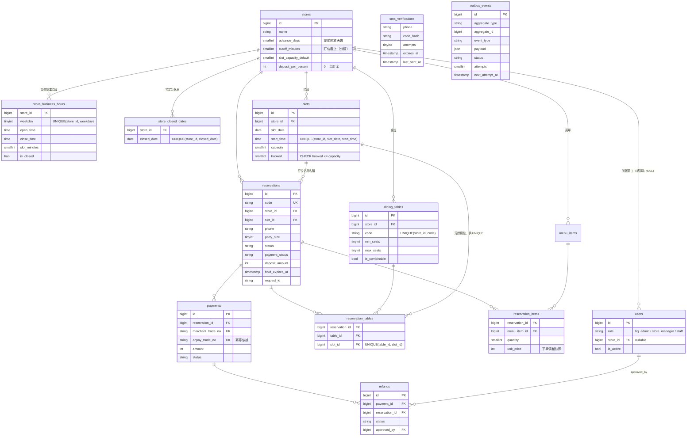

# ER 圖與資料表設計

對應 migration：`backend/database/migrations/2025_01_01_0000*`。

`sms_verifications` 與 `outbox_events` 不設外鍵：前者依手機號碼關聯、尚無訂位；後者以 `aggregate_type + aggregate_id` 多型關聯，方便日後擴充其他事件。

## 防超賣的三層防線

| 層級 | 機制 | 位置 |
|---|---|---|
| 1. 應用層 | `UPDATE slots SET booked = booked + ? WHERE id = ? AND booked + ? <= capacity`，以 affected rows 判斷 | 里程碑 4 實作 |
| 2. 桌位 | `UNIQUE(table_id, slot_id)`：同桌同時段不可被兩張有效訂位佔用 | `reservation_tables` |
| 3. DB 約束 | `CHECK (booked <= capacity)`：應用層有 bug 時 DB 仍拒絕超賣 | `slots` |

`reservation_tables` 的列必須在訂位取消／逾時釋放時一併刪除，否則會誤擋後續訂位。

## 關鍵索引

| 索引 | 用途 |
|---|---|
| `reservations(status, hold_expires_at)` | Scheduler 每分鐘釋放逾時保留 |
| `reservations(phone)` | 顧客「我的訂位」查詢 |
| `payments(status, created_at)` | 對帳排程掃描 pending 訂單 |
| `outbox_events(status, next_attempt_at)` | Worker 撈取待重試事件 |

## 設計取捨

- **狀態欄位用 `string` 而非 MySQL `ENUM`**：新增狀態不需 `ALTER TABLE`；合法值由 `app/Enums/*` 的 PHP Enum 約束。
- **桌位資料表命名為 `dining_tables`**：避免與 SQL 保留字 `tables` 混淆。
- **訂金為每人固定金額**：設定在 `stores.deposit_per_person`，訂位建立時算出 `reservations.deposit_amount` 並凍結，之後改門市設定不影響舊單。
- **菜單價格快照**：`reservation_items.unit_price` 記錄下單當下價格。
